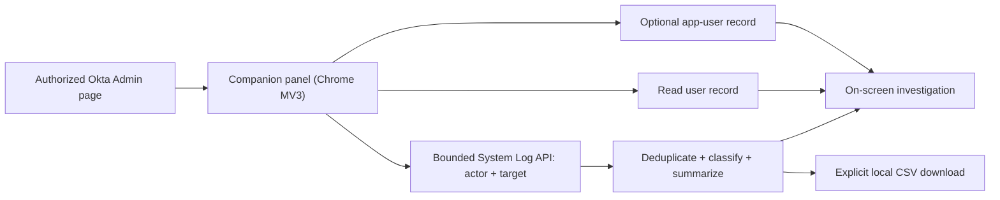

# Okta Diagnostics Companion

**Read-only sign-in, provisioning, and security investigations for Okta administrators.**


A small, independently written Chrome extension designed to run **alongside** the community [Rockstar](https://gabrielsroka.github.io/rockstar/) extension. Instead of duplicating Rockstar's API explorer and CSV tools, it focuses on **one user at a time**: what Okta recorded about their sign-in attempts, application assignment/provisioning, and relevant security events.

> **Important:** This is an early community prototype, **not an official Okta or Rockstar product**. It has unit tests but **has not been validated against a live Okta tenant**. Review and test in an authorized nonproduction organization before any enterprise deployment. Do not interpret the presence of an app assignment as proof that the user was successfully provisioned downstream.

## What it does (v0.1)

| Capability | Implementation |
| --- | --- |
| User lookup | Resolve one login/ID using `GET /api/v1/users/{id}` and display current Okta user status |
| User-related System Log | Bounded queries filtered separately by `actor.id` and `target.id`; deduplicated and ordered locally |
| Failure breakdown | Count observed `FAILURE` and `DENY` outcomes (Okta records policy denials as `DENY`) and classify relevant authentication, provisioning, and policy/security events |
| Application-specific evidence | Optional app ID: show the corresponding app-user record when accessible and filter log events explicitly targeting the app |
| Guided triage | Explain a few **observed event types** without inventing root causes |
| CSV evidence export | Explicit local download of currently displayed events, with CSV formula-injection protection |
| Privacy controls | No telemetry, no analytics, no API token prompt, no local storage; API calls go to the current Okta origin |

### Architecture



The extension accesses **only the current Okta organization origin**, using an existing authorized administrator browser session. It does not embed or collect an SSWS token and does not send log data to a third-party service.

## Try it in a test tenant

1. Download this repository and extract the folder locally.
2. In Chrome, open `chrome://extensions`, enable **Developer mode**, select **Load unpacked**, and choose the extracted project folder (containing `manifest.json`).
3. Sign into an **authorized nonproduction** Okta Admin Console whose hostname matches the supported origins below. Navigate to an `/admin` page.
4. Click **Okta diagnostics** (bottom right). Enter a test user's Okta ID or login; optionally enter a test application ID.
5. Select a time range of at most 31 days and click **Analyze user**. Review returned events and the findings. Click **Export displayed CSV** only when the exported records are approved for local handling.

**Supported origins:** `https://*.okta.com`, `https://*.okta-emea.com`, and `https://*.oktapreview.com`. The companion is **not yet tested** on custom domains, government domains, or alternative admin host layouts. Its UI loads on `/admin` paths only.

**Authorization:** Browser-session permissions depend on the Okta tenant, the signed-in admin's role, and browser session/CORS configuration. A `401` or `403` indicates missing authorization or session access, not necessarily a software defect. **Do not add privileged API tokens to extension source, browser storage, or screenshots** to work around this. A future release may implement properly scoped OAuth authentication.

## Query and evidence limitations

- System Log is queried using `GET /api/v1/logs`, with both `since` and `until` so pagination is **finite**. The companion uses `actor.id` and `target.id` separately because Okta events may identify a user in either position.
- It follows Okta's `Link: ... rel="next"` value **only** when the URL stays on the same HTTPS Okta origin and `/api/v1/logs` endpoint. It does not generate its own pagination cursors.
- It reads **at most three pages per user filter** (up to 600 raw records across both searches before deduplication). It flags truncated results: narrower time windows are required for more complete incident analysis.
- Some System Log events may arrive late. The absence of an event **does not prove** that no issue occurred.
- The optional app filter matches events whose `target` explicitly contains the app ID. Related events with missing/different app targets will not appear in that filtered view.
- User status, app assignment, app-user record status, downstream SCIM delivery, and successful end-user access are **different facts**. Do not conflate them.
- Displayed security indicators and guidance are **triage hints** anchored to recorded event types, not definitive incident attribution.
- Okta System Log records can contain personal and security-sensitive information including usernames and IP addresses. Generated CSVs should be stored and transmitted only under organizational policy.

## Test without an Okta tenant

Requires Node.js 20+:

```bash
node --test tests/*.test.cjs
```

Tests cover time bounds, filter construction, pagination origin restrictions, deduplication and page caps, event classification, app targeting, CSV output sanitization, and triage hints. These tests **do not** validate browser extension permissions or live Okta API behavior.

## Next roadmap

1. **V0.2:** Live end-to-end verification in an Okta test org, signed-in browser permission checks, and sanitized screenshots.
2. **V0.3:** Correlate related log events by `transaction.id`, session, app, and sequence, then show an evidence-backed timeline for login/SCIM failure investigations.
3. **V0.4:** Optional scoped OAuth (`okta.users.read`, `okta.apps.read`, `okta.logs.read`) and enhanced permission/error reporting.
4. **V0.5:** Detect common integration failures such as app API credential failures, rate limits, attribute mapping errors, and user-assignment changes; optional support-ticket export with PII redaction.
5. **Upstream proposal:** Discuss a focused diagnostic integration with Rockstar's maintainer after tests and reviews, instead of copying the older Manifest V2 repository.

## Technical choices

- **Vanilla JavaScript + Shadow DOM:** minimal dependencies and avoids CSS conflicts with Okta's admin UI.
- **Chrome Manifest V3:** avoids continuing development against an older Manifest V2 baseline.
- **Read-only methods:** all Okta API calls are `GET`; no app provisioning, user changes, or security-policy changes.
- **Explicit evidence export:** no automatic log transmission or persistent background collection.
- **Testable core:** classification, pagination security and CSV serialization are independent of the browser DOM.

## References

- [Okta System Log API query guide](https://developer.okta.com/docs/reference/system-log-query/)
- [Okta Event Types](https://developer.okta.com/docs/reference/api/event-types/)
- [Okta Applications API](https://developer.okta.com/docs/api/openapi/okta-management/management/tags/application)
- [OAuth for Okta API endpoints](https://developer.okta.com/docs/guides/implement-oauth-for-okta/main/)
- [Rockstar project](https://gabrielsroka.github.io/rockstar/)

## Attribution and independence

This repository is an **original companion implementation** and does not copy Rockstar source code. Rockstar is a separate, community-created project by Gabriel Sroka. This repository is neither sponsored nor supported by Okta, Rockstar, or an employer. All examples and tests are synthetic. Contributions and security reports are welcome.

## License

MIT — see [LICENSE](LICENSE).
