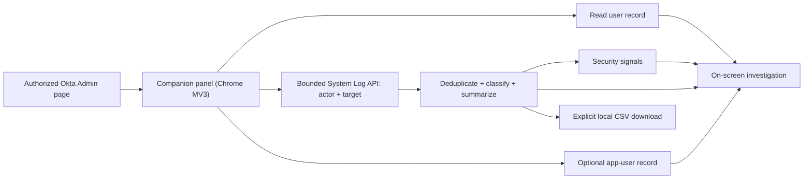

# Okta Diagnostics Companion

**Read-only sign-in, provisioning, and security investigations for Okta administrators.**


A small, independently written Chrome extension designed to run **alongside** the community [Rockstar](https://gabrielsroka.github.io/rockstar/) extension. Instead of duplicating Rockstar's API explorer and CSV tools, it focuses on **one user at a time**: what Okta recorded about their sign-in attempts, application assignment/provisioning, and relevant security events.

> **Important:** This is an early community prototype, **not an official Okta or Rockstar product**. It has unit tests but **has not been validated against a live Okta tenant**. Review and test in an authorized nonproduction organization before any enterprise deployment. Do not interpret the presence of an app assignment as proof that the user was successfully provisioned downstream.

## What it does (v0.1)

| Capability | Implementation |
| --- | --- |
| User lookup | Resolve one login/ID using `GET /api/v1/users/{id}` and display current Okta user status |
| User-related System Log | Bounded queries filtered separately by `actor.id` and `target.id`; deduplicated and ordered locally |
| Failure breakdown | Count observed `FAILURE` and `DENY` outcomes (Okta records policy denials as `DENY`) and classify relevant authentication, provisioning, and policy/security events |
| Application-specific evidence | Optional app ID: show the corresponding app-user record when accessible and filter log events explicitly targeting the app |
| Provisioning diagnosis | Group provisioning events into attempts by `transaction.id`, read the error text Okta recorded, map it to a likely cause (see below) with what to check, interpret the app-user `syncState`/`status`, and flag a later matching SUCCESS event (same user, app, and operation; not proof of downstream recovery) |
| Security signals | Turn the user's recorded events into prioritized leads: MFA fatigue, user-reported suspicious activity, MFA factor removal, admin privilege grants, support impersonation, risky or new-location sign-ins, Identity Threat Protection and partner risk, lockouts, ThreatInsight, and possible account-takeover sequences (see below) |
| Guided triage | Explain a few **observed event types** without inventing root causes |
| CSV evidence export | Explicit local download of currently displayed events, with CSV formula-injection protection |
| Privacy controls | No telemetry, no analytics, no API token prompt, no local storage; API calls go to the current Okta origin |

### Architecture



The extension accesses **only the current Okta organization origin**, using an existing authorized administrator browser session. It does not embed or collect an SSWS token and does not send log data to a third-party service.

## Try it in a test tenant

1. Download this repository and extract the folder locally.
2. In Chrome, open `chrome://extensions`, enable **Developer mode**, select **Load unpacked**, and choose the extracted project folder (containing `manifest.json`).
3. Sign into an **authorized nonproduction** Okta Admin Console whose hostname matches the supported origins below. Navigate to an `/admin` page.
4. Click **Okta diagnostics** (bottom right). Enter a test user's Okta ID or login; optionally enter a test application ID.
5. Select a time range of at most 31 days and click **Analyze user**. Review returned events and the findings. Click **Export displayed CSV** only when the exported records are approved for local handling.

**Supported origins:** `https://*.okta.com`, `https://*.okta-emea.com`, and `https://*.oktapreview.com`. The companion is **not yet tested** on custom domains, government domains, or alternative admin host layouts. Its UI loads on `/admin` paths only.

**Authorization:** Browser-session permissions depend on the Okta tenant, the signed-in admin's role, and browser session/CORS configuration. A `401` or `403` indicates missing authorization or session access, not necessarily a software defect. **Do not add privileged API tokens to extension source, browser storage, or screenshots** to work around this. A future release may implement properly scoped OAuth authentication.

## Security signals

The panel turns one user's System Log events into **prioritized leads** for an investigator. Each signal shows what was observed, why it matters, next steps, and the supporting events (time, event type, outcome, actor, IP, location, client). Signals use all of the user's events in the window, even when an app filter is set.

| Signal | Severity | Based on |
| --- | --- | --- |
| Possible account takeover sequence | High | A risky, impossible-travel or new-country sign-in, or an accepted MFA-fatigue sequence, followed within 24 hours by MFA removal/reset, password reset, admin privilege grant or impersonation. A new factor enrolment counts only alongside a factor removal, so a routine new device is not flagged. |
| Denied MFA pushes followed by a successful sign-in | High | 2+ Okta Verify push denials within 10 minutes, then a successful authentication within 10 minutes (`user.mfa.okta_verify.deny_push`; Identity Engine `user.authentication.auth_via_mfa` failures with factor `OKTA_VERIFY_PUSH`) |
| Repeated MFA push denials | Medium | 3+ push denials within 10 minutes without a following success |
| User reported suspicious activity | High | `user.account.report_suspicious_activity_by_enduser` |
| Admin privileges granted | High | `user.account.privilege.grant` |
| Risky / impossible-travel sign-in | High or Medium | Okta risk level `HIGH`/`MEDIUM`, or `Velocity=POSITIVE` behavior, on `user.session.start` / `policy.evaluate_sign_on` |
| New location, device or network | Low | Okta behavior detection (`New Country`, `New Geo-Location`, `New Device`, `New IP`, `New ASN`, …) |
| Identity Threat Protection / partner risk | By risk level | `user.risk.detect` (including *Security Events Provider Reported Risk* from partners such as CrowdStrike) and `security.events.provider.receive_event` |
| MFA factor removed or reset | Medium | `user.mfa.factor.deactivate`, `reset_all`, `suspend` (security-question resets ignored), noting whether another account performed it |
| Support impersonation | Medium | `user.session.impersonation.grant` / `initiate` |
| Account locked after failed sign-ins | Medium, High if failures came from 3+ IPs | `user.account.lock` with failed sign-ins in the preceding hour |
| Okta detected a security threat | Medium | `security.threat.detected` |

Thresholds follow widely published detection logic for Okta (for example 2 push denials then a success within 10 minutes for MFA fatigue) and are deliberately conservative.

**Coverage notes** appear when data is missing, so an empty result isn't mistaken for a clean account:
- Risk and behavior details appear on sign-in events only when sign-on policies evaluate risk or behavior.
- `user.risk.detect` and partner signals require Okta Identity Threat Protection. Okta records the partner event, but the original context lives in the partner console (for example the EDR).

Signals are **leads, not verdicts**. Confirm with the user through a trusted channel and follow your incident response procedure before taking action. The extension never changes the account.

## Provisioning diagnosis

When a user fails to provision to an app, the panel shows each failed attempt with a likely cause, why it happens, what to check, and the exact text Okta recorded. Causes are matched **only** from error text present on the event (`outcome.reason` and error-like `debugContext.debugData` fields; request URLs and secret-like keys are ignored):

| Cause | Matched from recorded text such as |
| --- | --- |
| Downstream rate limit | `429`, "rate limit", "too many requests" |
| Account already exists / conflict | `409`, "already exists", "duplicate" |
| Integration credentials rejected | `401`/`403`, "unauthorized", "invalid token", "expired credential" |
| User or resource not found in app | `404`, "not found", "does not exist" |
| License or quota exhausted | "license", "seats", "quota" |
| Response format not readable | "unable to parse", "content-type", "scim+json" |
| Attribute or profile value rejected | `400`/`422`, "required attribute", "invalid value", "schema", "validation" |
| Application unavailable | `5xx`, "timeout", "connection refused", TLS/certificate errors |
| Provisioning action disabled | "provisioning not enabled", "push disabled" |

Okta often logs provisioning failures (for example `application.provision.user.sync` with legacy type `app.user_management.provision_user_failed`) **without** any error text. In that case the companion says so and points to **Dashboard > Tasks** (or the error icon on the app's Assignments tab), where Okta keeps the full error and a Retry option. It does not guess.

With an app ID, the app-user record's `syncState` is also interpreted: `ERROR` (last sync failed), `OUT_OF_SYNC`, `SYNCING`, `DISABLED`, or `SYNCHRONIZED`, together with `STAGED`/`PENDING` status and `lastSync`. The CSV export includes a `cause` column for failed provisioning events. A later `SUCCESS` record is displayed as a **possible successful retry** only when the user ID, app ID, and event type match the failed operation; actual downstream access still requires separate confirmation.

## Query and evidence limitations

- System Log is queried using `GET /api/v1/logs`, with both `since` and `until` so pagination is **finite**. The companion uses `actor.id` and `target.id` separately because Okta events may identify a user in either position.
- It follows Okta's `Link: ... rel="next"` value **only** when the URL stays on the same HTTPS Okta origin and `/api/v1/logs` endpoint. It does not generate its own pagination cursors.
- It reads **at most three pages per user filter** (up to 600 raw records across both searches before deduplication). It flags truncated results: narrower time windows are required for more complete incident analysis.
- Some System Log events may arrive late. The absence of an event **does not prove** that no issue occurred.
- The optional app filter matches events whose `target` explicitly contains the app ID. Related events with missing/different app targets will not appear in that filtered view.
- User status, app assignment, app-user record status, downstream SCIM delivery, and successful end-user access are **different facts**. Do not conflate them.
- Displayed security indicators and guidance are **triage hints** anchored to recorded event types, not definitive incident attribution.
- Error details from Okta are untrusted and can accidentally contain credentials or personal data. The companion applies best-effort **value-level redaction** of tokens, passwords, URLs, email addresses and IP addresses to displayed error text and CSV message/reason fields. This is not an exhaustive DLP system; inspect any export before sharing.
- A recovery indicator requires a later matching successful event for the **same user, application and provisioning event type**. It does not establish downstream account health, and related failures may remain unresolved.
- Do not unassign/reassign users, alter profile mappings, or retry destructive changes solely on an automated hint. Validate consequences with the application owner and follow approved change procedures.
- Okta System Log records can contain personal and security-sensitive information including usernames and IP addresses. Generated CSVs should be stored and transmitted only under organizational policy.

## Test without an Okta tenant

Requires Node.js 20+:

```bash
node --test tests/*.test.cjs
```

Tests cover time bounds, filter construction, pagination origin restrictions, deduplication and page caps, event classification, app targeting, CSV output sanitization, triage hints, and provisioning cause classification, attempt grouping and app-user interpretation using synthetic fixtures. These tests **do not** validate browser extension permissions or live Okta API behavior.

## Next roadmap

1. **V0.2:** Live end-to-end verification in an Okta test org, signed-in browser permission checks, and sanitized screenshots.
2. **V0.3:** ~~Provisioning failure diagnosis grouped by `transaction.id`~~ (done). Next: a full sign-in timeline correlated by session and sequence.
3. **V0.4:** Optional scoped OAuth (`okta.users.read`, `okta.apps.read`, `okta.logs.read`) and enhanced permission/error reporting.
4. **V0.5:** ~~Security signals: MFA fatigue, lockouts, risky/new-location sign-ins, ITP and partner risk, factor and privilege changes, account-takeover sequences~~ (done). Next: links that open the same user in SailPoint and CrowdStrike Falcon consoles (configured URLs, your own SSO session, no stored secrets).
5. **V0.6:** Copyable support-ticket summary of a diagnosis with PII redaction, and an app-wide view of provisioning failures across users.
6. **Upstream proposal:** Discuss a focused diagnostic integration with Rockstar's maintainer after tests and reviews, instead of copying the older Manifest V2 repository.

## Technical choices

- **Vanilla JavaScript + Shadow DOM:** minimal dependencies and avoids CSS conflicts with Okta's admin UI.
- **Chrome Manifest V3:** avoids continuing development against an older Manifest V2 baseline.
- **Read-only methods:** all Okta API calls are `GET`; no app provisioning, user changes, or security-policy changes.
- **Explicit evidence export:** no automatic log transmission or persistent background collection.
- **Testable core:** classification, pagination security, CSV serialization and security detections (`src/security.js`) are independent of the browser DOM.

## References

- [Okta System Log API query guide](https://developer.okta.com/docs/reference/system-log-query/)
- [Okta Event Types](https://developer.okta.com/docs/reference/api/event-types/)
- [Okta: System Log queries for attempted account takeover](https://support.okta.com/help/s/article/System-Log-queries-for-attempted-account-takeover)
- [Okta: Behavior Detection System Log events](https://help.okta.com/oie/en-us/content/topics/security/behavior-detection/logs-behavior-detection.htm)
- [Okta: Configure a shared signal receiver (ITP)](https://help.okta.com/oie/en-us/content/topics/itp/configure-shared-signal-provider.htm)
- [Okta Applications API](https://developer.okta.com/docs/api/openapi/okta-management/management/tags/application)
- [OAuth for Okta API endpoints](https://developer.okta.com/docs/guides/implement-oauth-for-okta/main/)
- [Rockstar project](https://gabrielsroka.github.io/rockstar/)

## How this was built

Okta Diagnostics Companion is designed and maintained by Andrew Yonan and built with **Claude**, Anthropic's AI model, as a coding partner. Using AI is a deliberate part of how this project is engineered, not something hidden.

| Andrew decides | Claude does, under review |
| --- | --- |
| What to investigate and why, from Okta administration experience | Drafts detection logic, tests and documentation |
| The security model: read-only, the admin's own session, no stored tokens, no telemetry | Checks Okta event names and fields against Okta's documentation |
| Which signals and thresholds are worth flagging, and how conservative to be | Proposes options and argues for and against them |
| What merges | Opens pull requests for review |

Every change goes through a pull request, must pass the automated tests (36 at the time of writing, using synthetic fixtures only) and merges into a protected `main` branch. Detection rules still need confirming in a nonproduction Okta tenant before they are relied on. Commits written with Claude carry a `Co-Authored-By: Claude` trailer from this change on; earlier commits were also made with Claude's help and predate the trailer.

## Attribution and independence

This repository is an **original companion implementation** and does not copy Rockstar source code. Rockstar is a separate, community-created project by Gabriel Sroka. This repository is neither sponsored nor supported by Okta, Rockstar, or an employer. All examples and tests are synthetic. Contributions and security reports are welcome.

## License

MIT — see [LICENSE](LICENSE).
